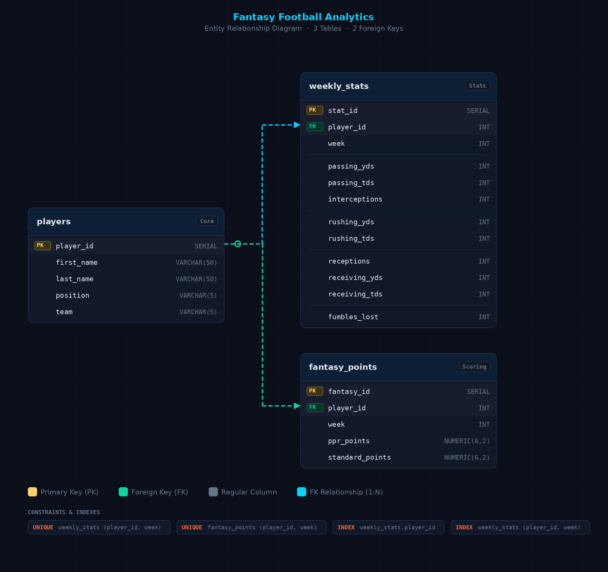

# Fantasy Football Analytics

**Personal Project | PostgreSQL, SQL, TypeScript, Next.js, Data Analytics**

A fantasy football analytics dashboard built on a PostgreSQL analytics layer. It pulls weekly NFL stats and projections from the Sleeper API into Postgres, computes fantasy points and advanced metrics in SQL views, and serves them through a Next.js dashboard.

---

## Features

| Page | What it does |
|------|--------------|
| **Home** | Animated landing page built on live data: the hottest player right now, a ribbon of today’s most-added players, a buy-low / sell-high spotlight, and a live dynasty trade |
| **Overview** | Waiver buzz, players heating up, last week's top scorers, softest defenses by position |
| **Trending** | Most added/dropped players across Sleeper leagues (24h / 3d / 7d), form risers and fallers (last 3 games vs. season), snap share risers, and buy-low / sell-high players where the market and our model disagree |
| **Rankings** | Rest-of-season outlook with tiers, VOR, and trade value, or full season stats (2023–present) with floor, ceiling, boom/bust rates, and snap share |
| **Player profiles** | Weekly points chart with upcoming projections, game log, season-by-season history, and next matchup rating |
| **Start/Sit** | Compare up to 6 players for the upcoming week using projection, recent form, and opponent strength vs. the position |
| **Trade calculator** | Redraft or Dynasty mode. Value both sides of a trade with league size and Superflex settings, a package discount for multi-player deals, and suggestions to balance uneven trades. Dynasty mode adds rookie picks (Early / Mid / Late, rounds 1–4, next three drafts). |
| **Matchups** | Heatmap of fantasy points each defense allows to QB / RB / WR / TE vs. league average |

Every page supports **PPR, Half PPR, and Standard** scoring via the toggle in the header.

---

## Architecture

```
Sleeper API ──► scripts/ingest.ts ──► PostgreSQL (tables + analytics views) ──► Next.js dashboard
                                                                     ▲
                    Sleeper trending adds/drops (live, cached 15 min) ┤
                    FantasyCalc market trade values (live, cached 1 day) ┘
```

### Database (`db/`)

| Table | Description |
|-------|-------------|
| `players` | Sleeper player registry: name, position, team, age, injury status |
| `weekly_stats` | One row per player per game played (`season`, `week`, opponent, passing/rushing/receiving stats, targets, snaps) |
| `projections` | Sleeper weekly projections for upcoming weeks |
| `scoring_formats` | One row per scoring format, one column per rule. Add a row to support a custom league format. |

| View | Description |
|------|-------------|
| `v_fantasy_points` | Fantasy points per player-week for every scoring format (`weekly_stats × scoring_formats`) |
| `v_weekly_ranks` | Weekly positional finish via `RANK() OVER (PARTITION BY season, week, format, position)` |
| `v_season_summary` | Games, total, average, standard deviation, floor/ceiling (`PERCENTILE_CONT`), last-3 form (`ROW_NUMBER`), boom/bust rates, snap share |
| `v_points_allowed` | Fantasy points allowed by each defense to each position, with league average and matchup factor |

### Models (`lib/`)

- **Outlook** (`model.ts`): projected points per game, blending Sleeper projections (50%) with current-season form. Last season fills in while the current-season sample is small, then fades out.
- **Model value**: outlook above a waiver-level player at the position, scaled 0–100. Replacement level adjusts for league size and Superflex.
- **Dynasty value**: the same edge carried forward five seasons along position-specific age curves (RBs decline from 26, WRs from 28, TEs from 29, QBs from 33), discounted 20% per year.
- **Trade value** (`blend.ts`, `values.ts`): 60% market value from [FantasyCalc](https://fantasycalc.com) (prices from real fantasy trades) + 40% model value. The model is first mapped onto the market’s value curve by rank, so the two are compared on rank, not curve shape. When they differ by 25%+ the player is tagged **buy low** (model higher) or **sell high** (market higher). Injured players are never tagged. Falls back to model-only if FantasyCalc is unavailable.
- **Draft picks** (`picks.ts`): market values when available, otherwise fixed values on the dynasty scale. An early 1st is worth about a top-15 dynasty WR. Picks two drafts out are discounted 15%, and Superflex boosts 1sts and 2nds.
- **Start/sit** (`startsit.ts`): 60% projection + 40% recent form × matchup factor. The matchup factor is shrunk halfway toward neutral because defensive samples are noisy.

---

## Getting started

Requires **Node 20+** and **Docker**.

```bash
npm install
npm run db:up          # Postgres 16 on localhost:5433 (schema + views load automatically)
npm run ingest:all     # backfill 2023–2026 from Sleeper (a few minutes)
npm run dev            # http://localhost:3000
```

During the season, run `npm run ingest` to refresh the current season and upcoming projections. You can also target specific weeks: `npm run ingest -- --seasons 2026 --weeks 7`.

---

## Project history

v1 of this project was a pure SQL analytics engine run in pgAdmin. Those files are kept in `sql/`, `scripts/generate_seed_data.py`, and `screenshots/`. v2 made these changes:

- Added `season` and `opponent` columns, so seasons no longer overwrite each other and matchup analysis is possible.
- Stopped inserting zero-stat rows for byes and inactive weeks, which had been dragging down averages and consistency scores.
- Fixed integer division in the PPR formula (`rushing_yds / 10`). Points now match Sleeper's exactly in all three formats.

## Entity Relationship Diagram (v1)


---

## Contact

Created by Michael John.
Feel free to connect with me on [LinkedIn](https://www.linkedin.com/in/michael-john-06a098359/).
