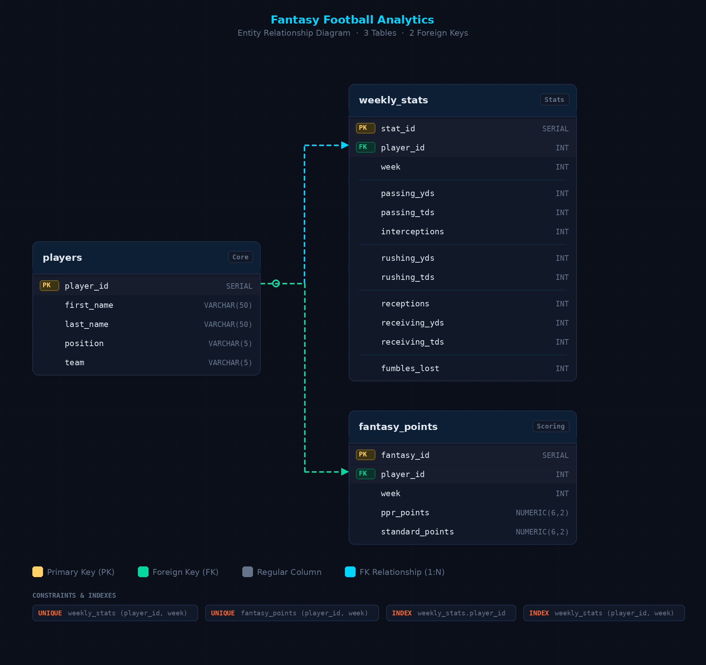

# Fantasy Football Analytics

**Personal Project | PostgreSQL, SQL, TypeScript, Next.js, Data Analytics**

A fantasy football analytics dashboard built on a PostgreSQL analytics layer. It pulls weekly NFL stats and projections from the Sleeper API into Postgres, computes fantasy points and advanced metrics in SQL views, and serves them through a Next.js dashboard.

---

## Features

| Page | What it does |
|------|--------------|
| **Home** | Animated landing page built on live data: the hottest player right now, a ribbon of today’s most-added players, a buy-low / sell-high spotlight, and a live dynasty trade |
| **Overview** | Waiver buzz, players heating up, last week's top scorers, softest defenses by position |
| **League** | Your Sleeper league: standings with the playoff line, every week's matchups and top scorers, and your roster (pick your team once and the site remembers it) |
| **League paper** | A weekly newspaper about your league, the same for everyone: a front-page story on the game of the week, recaps of every matchup, stars and duds, awards (high score, luckiest win, toughest loss), bench blunders, the transaction wire, standings movement, and previews of next week with projections in your league's scoring |
| **Trending** | Most added/dropped players across Sleeper leagues (24h / 3d / 7d), form risers and fallers (last 3 games vs. season), snap share risers, and buy-low / sell-high players where the market and our model disagree |
| **Rankings** | Rest-of-season outlook with tiers, VOR, and trade value, or full season stats (2014–present) with floor, ceiling, boom/bust rates, and snap share |
| **Player profiles** | Weekly points chart with upcoming projections, game log, season-by-season history, and next matchup rating |
| **Start/Sit** | Compare up to 6 players for the upcoming week using projection, recent form, and opponent strength vs. the position |
| **Trade calculator** | Redraft or Dynasty mode. Value both sides of a trade with league size and Superflex settings, a package discount for multi-player deals, and suggestions to balance uneven trades. Dynasty mode adds rookie picks (Early / Mid / Late, rounds 1–4, next three drafts). |
| **Matchups** | Heatmap of fantasy points each defense allows to QB / RB / WR / TE vs. league average |

Every page supports **PPR, Half PPR, and Standard** scoring via the toggle in the header.

---

## Architecture

```
Sleeper API ──► scripts/ingest.ts ──► PostgreSQL (tables + analytics views) ──► Next.js dashboard
                                                                     ▲
                    Sleeper trending adds/drops (live, cached 15 min) ┤
                    FantasyCalc market trade values (live, cached 1 day) ┘
```

### Database (`db/`)

| Table | Description |
|-------|-------------|
| `players` | Sleeper player registry: name, position, team, age, injury status |
| `weekly_stats` | One row per player per game played (`season`, `week`, opponent, passing/rushing/receiving stats, targets, snaps) |
| `projections` | Sleeper weekly projections for upcoming weeks |
| `scoring_formats` | One row per scoring format, one column per rule. Add a row to support a custom league format. |
| `leagues`, `league_users`, `league_rosters`, `league_roster_players` | Imported Sleeper league: settings and scoring rules, managers, standings, and who is on each roster (starter / bench / taxi / IR) |
| `league_matchups` | One row per team per week: score, starters, and every rostered player's points. Future weeks hold the schedule. |
| `league_transactions`, `league_traded_picks` | Trades, waiver claims (with FAAB bids), and free-agent moves; current owner of every traded future pick |

| View | Description |
|------|-------------|
| `v_fantasy_points` | Fantasy points per player-week for every scoring format (`weekly_stats × scoring_formats`) |
| `v_weekly_ranks` | Weekly positional finish via `RANK() OVER (PARTITION BY season, week, format, position)` |
| `v_season_summary` | Games, total, average, standard deviation, floor/ceiling (`PERCENTILE_CONT`), last-3 form (`ROW_NUMBER`), boom/bust rates, snap share |
| `v_points_allowed` | Fantasy points allowed by each defense to each position, with league average and matchup factor |

### Models (`lib/`)

- **Outlook** (`model.ts`): projected points per game, blending Sleeper projections (50%) with current-season form. Last season fills in while the current-season sample is small, then fades out.
- **Model value**: outlook above a waiver-level player at the position, scaled 0–100. Replacement level adjusts for league size and Superflex.
- **Dynasty value**: the same edge carried forward five seasons along position-specific age curves (RBs decline from 26, WRs from 28, TEs from 29, QBs from 33), discounted 20% per year.
- **Trade value** (`blend.ts`, `values.ts`): 60% market value from [FantasyCalc](https://fantasycalc.com) (prices from real fantasy trades) + 40% model value. The model is first mapped onto the market’s value curve by rank, so the two are compared on rank, not curve shape. When they differ by 25%+ the player is tagged **buy low** (model higher) or **sell high** (market higher). Injured players are never tagged. Falls back to model-only if FantasyCalc is unavailable.
- **Draft picks** (`picks.ts`): market values when available, otherwise fixed values on the dynasty scale. An early 1st is worth about a top-15 dynasty WR. Picks two drafts out are discounted 15%, and Superflex boosts 1sts and 2nds.
- **Start/sit** (`startsit.ts`): 60% projection + 40% recent form × matchup factor. The matchup factor is shrunk halfway toward neutral because defensive samples are noisy.

---

## Getting started

Requires **Node 24+** and **Docker**.

```bash
npm install
npm run db:up          # Postgres 16 on localhost:5433 (schema + views load automatically)
npm run ingest:all     # backfill 2014–present from Sleeper (about 10 minutes)
npm run dev            # http://localhost:3000
```

During the season, run `npm run ingest` to refresh the current season and upcoming projections. You can also target specific weeks: `npm run ingest -- --seasons 2026 --weeks 7`.

### Your league

Import a Sleeper league with its ID, the number in the league's URL on sleeper.com:

```bash
npm run league -- --league <league ID>
```

This loads the league's settings, managers, rosters, every week's matchups, transactions, and traded picks, then follows `previous_league_id` to import past seasons too (`--no-history` skips them). Re-run it to refresh. To pin the site to one league, add `LEAGUE_ID=<league ID>` to `.env.local`; otherwise the most recently imported season is used.

### League paper

After each week's games are final, refresh the league and publish that week's edition:

```bash
npm run league
npm run paper                  # latest final week; or --week 9
```

Every fact (scores, awards, standings, all-play luck, projections) is computed in `lib/newspaper/facts.ts`, and `lib/newspaper/writer.ts` turns them into stories from templates. Each edition is stored whole in `league_editions`, so everyone reads the same paper and it never changes; `--force` rewrites one. Previews score Sleeper's projected stats with the league's own rules (`lib/newspaper/scoring.ts`, which reproduces Sleeper's points exactly).

**Existing database?** Run `npm run db:migrate` after pulling schema changes. Every file in `db/` is safe to re-run.

### Historical data

Weekly stats go back to **2014**, the first season where Sleeper covers every player (2009–2013 only includes some, which would bias the history toward players with long careers). Field coverage varies: targets and air yards exist for every season, **snap counts start in 2020** (stored as `NULL`, not zero, before that), and relocated franchises use their current codes (OAK→LV, SD→LAC, STL→LAR) so defense history lines up.

### Projection snapshots

Sleeper edits its historical projections after games, so they can't be trusted as pre-game data for model training. The **Projection snapshots** workflow (`.github/workflows/projection-snapshots.yml`) saves projections every morning, plus Monday and Thursday afternoons, to the `projection-snapshots` branch. Run one locally with `npm run snapshot`.

---

## Project history

v1 of this project was a pure SQL analytics engine run in pgAdmin. Those files are kept in `sql/`, `scripts/generate_seed_data.py`, and `screenshots/`. v2 made these changes:

- Added `season` and `opponent` columns, so seasons no longer overwrite each other and matchup analysis is possible.
- Stopped inserting zero-stat rows for byes and inactive weeks, which had been dragging down averages and consistency scores.
- Fixed integer division in the PPR formula (`rushing_yds / 10`). Points now match Sleeper's exactly in all three formats.

## Entity Relationship Diagram (v1)


---

## Contact

Created by Michael John.
Feel free to connect with me on [LinkedIn](https://www.linkedin.com/in/michael-john-06a098359/).
